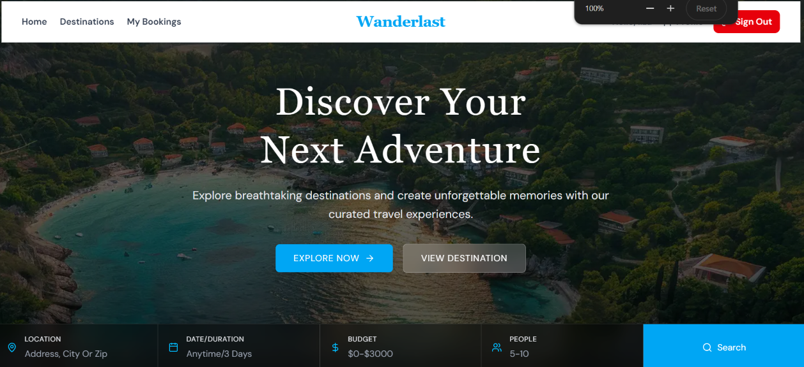
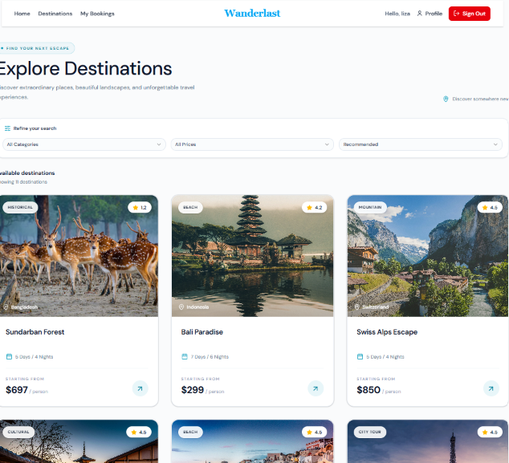
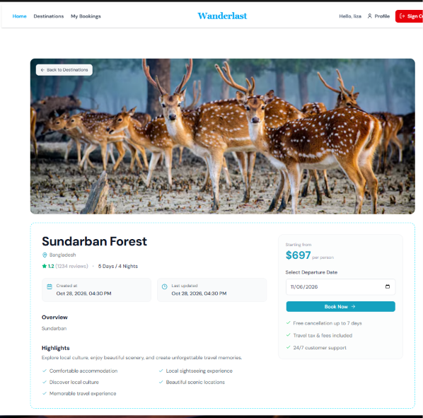
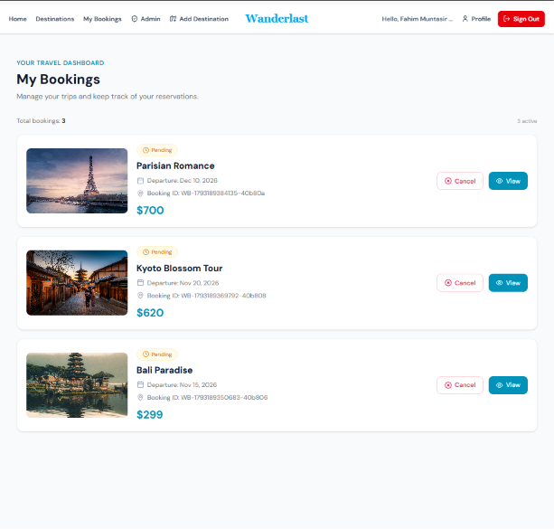
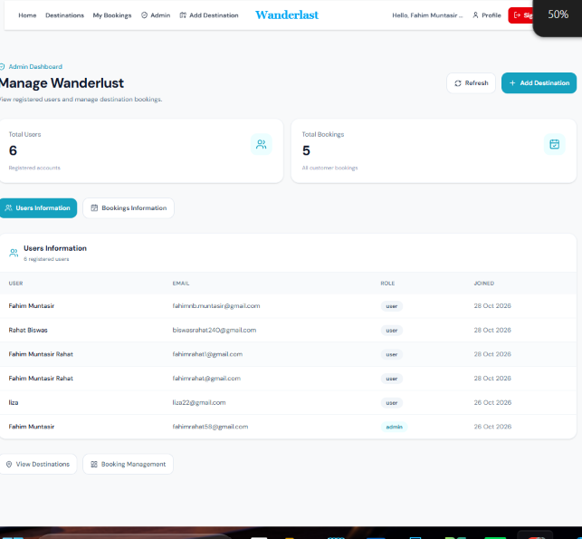

# 🌍 Wanderlust — Travel Booking Platform

<p align="center">
  
  
  
  
  
</p>

<p align="center">
  Discover beautiful destinations, explore unforgettable trips, and manage your travel bookings with Wanderlust — a full-stack travel booking platform built with Next.js, Express, MongoDB, and Better Auth.
</p>

<p align="center">
  <a href="https://wanderlust-five-rose.vercel.app/"><strong>🚀 Live Demo</strong></a>
  &nbsp; • &nbsp;
  <a href="#-screenshots"><strong>📸 Screenshots</strong></a>
  &nbsp; • &nbsp;
  <a href="#-getting-started"><strong>⚙️ Installation</strong></a>
</p>

---

## 📸 Screenshots

<!-- Add your screenshots to the frontend repository's public/screenshots/ directory. -->

<p align="center">
  
</p>
<p align="center"><em>Homepage — Discover your next adventure.</em></p>

<p align="center">
  
  &nbsp;
  
</p>
<p align="center"><em>Explore destinations and view detailed trip information.</em></p>

<p align="center">
  
  &nbsp;
  
</p>
<p align="center"><em>Manage travel bookings and access administrative features.</em></p>

> Replace these placeholder image paths with your actual screenshots. Only add screenshots for features and pages available in your application.

## ✨ Features

- 🧭 **Explore Destinations** — Browse travel destinations and discover detailed trip information.
- 🔐 **Secure Authentication** — Register and sign in using email and password with Better Auth.
- 🌐 **Google OAuth** — Sign in conveniently with your Google account.
- 🎟️ **Travel Bookings** — Create and view bookings through your account.
- 👤 **Profile Management** — View and update your profile information.
- 🛡️ **Admin Dashboard** — Access administrative features with configured admin authorization.
- 🔑 **JWT-Protected APIs** — Authenticate protected backend requests using Bearer tokens.
- 📱 **Responsive Design** — Enjoy a consistent experience across desktop, tablet, and mobile.
- ⚡ **Modern Interface** — Built with Tailwind CSS, shadcn/ui, and Lucide icons.

## 🛠️ Tech Stack

| Category | Technologies |
|---|---|
| Frontend | Next.js 16, React 19, TypeScript |
| Styling | Tailwind CSS 4 |
| UI Components | shadcn/ui, Lucide React |
| Authentication | Better Auth, JWT Plugin, Google OAuth |
| Backend | Node.js, Express |
| Database | MongoDB |
| Notifications | React Hot Toast |
| Date Utilities | date-fns |
| Deployment | Vercel and a separately deployed Express API |

## 🏗️ Architecture

Wanderlust uses a separate frontend and backend architecture, allowing each application to be developed and deployed independently.

```text
                  ┌─────────────────────────┐
                  │      Next.js Frontend   │
                  │       React + TypeScript│
                  └────────────┬────────────┘
                               │
                   Authenticated API Requests
                       Bearer JWT Token
                               │
                  ┌────────────▼────────────┐
                  │      Express Backend    │
                  │  API + Authorization    │
                  └────────────┬────────────┘
                               │
                  ┌────────────▼────────────┐
                  │         MongoDB         │
                  │  Destinations/Bookings  │
                  └─────────────────────────┘

             Better Auth handles user authentication
```

## 📂 Frontend Project Structure

```text
src/
├── app/
│   ├── (auth)/
│   ├── admin/
│   ├── adddestinations/
│   ├── api/
│   │   ├── auth/
│   │   └── bookings/
│   ├── bookings/
│   ├── destinations/
│   ├── profile/
│   ├── layout.tsx
│   └── page.tsx
├── components/
│   ├── homepage/
│   ├── ui/
│   └── destination-details-client.tsx
└── lib/
    ├── api.ts
    ├── auth.ts
    ├── auth-client.ts
    └── mongodb.ts
```

## 🚀 Getting Started

### Prerequisites

Make sure you have the following installed or configured:

- Node.js (LTS recommended)
- npm
- MongoDB database and connection string
- Better Auth secret
- Google OAuth credentials (optional if you do not use Google sign-in)
- Wanderlust backend API

### 1. Clone the frontend repository

```bash
git clone <YOUR_FRONTEND_REPOSITORY_URL>
cd <YOUR_FRONTEND_PROJECT_FOLDER>
```

### 2. Install dependencies

```bash
npm install
```

### 3. Configure environment variables

Create a `.env.local` file in the frontend root directory:

```env
NEXT_PUBLIC_APP_URL=http://localhost:3000

NEXT_PUBLIC_API_URL=http://localhost:5000

BETTER_AUTH_URL=http://localhost:3000
NEXT_PUBLIC_BETTER_AUTH_URL=http://localhost:3000

BETTER_AUTH_SECRET=your_secure_random_secret

BETTER_AUTH_TRUSTED_ORIGINS=http://localhost:3000

MONGODB_URI=your_mongodb_connection_string

GOOGLE_CLIENT_ID=your_google_client_id
GOOGLE_CLIENT_SECRET=your_google_client_secret

ADMIN_EMAIL=admin@example.com
```

**Environment configuration notes:**

- Replace all example values with your own credentials.
- `NEXT_PUBLIC_API_URL` must point to your running Express backend.
- Configure Better Auth URLs and trusted origins for your environment.
- Configure the Google OAuth redirect URI according to your Better Auth setup.
- Use the same expected authentication issuer and signing configuration across the frontend and backend.
- Keep database credentials, OAuth client secrets, and authentication secrets private.
- Never commit `.env.local` to Git.

### 4. Start the development server

```bash
npm run dev
```

Open [http://localhost:3000](http://localhost:3000) in your browser.

### 5. Build for production

```bash
npm run build
npm run start
```

Run the project's lint script if configured:

```bash
npm run lint
```

## 🔌 Backend Setup

The Express backend runs independently from the frontend.

1. Clone the backend repository.
2. Install its dependencies.
3. Configure the backend environment variables.
4. Connect the application to MongoDB.
5. Configure authentication token verification and CORS.
6. Start the backend server.
7. Set `NEXT_PUBLIC_API_URL` in the frontend to the backend's base URL.

```bash
git clone <YOUR_BACKEND_REPOSITORY_URL>
cd <YOUR_BACKEND_PROJECT_FOLDER>
npm install
```

Use the backend repository's README for its exact environment variables, available endpoints, and start command.

## 🌐 Deployment

### Frontend — Vercel

**Live application:** https://wanderlust-five-rose.vercel.app/

1. Import the frontend repository into Vercel.
2. Configure the required environment variables.
3. Set the backend API URL to the deployed Express API.
4. Configure Better Auth URLs and trusted origins.
5. Configure Google OAuth redirect settings.
6. Deploy and test the application.

### Backend — Express Hosting

Deploy the backend to a Node.js-compatible hosting provider.

Configure the MongoDB connection, authentication verification, admin authorization, and CORS before exposing the API publicly.

> A successful frontend deployment does not guarantee that authentication, database access, or protected backend endpoints are working correctly. Test the complete application after deployment.

## 🔐 Security

- Store sensitive credentials in environment variables.
- Use HTTPS in production.
- Validate and verify JWTs on the backend before processing protected requests.
- Enforce admin permissions on the backend, not only in the frontend interface.
- Restrict CORS to approved origins.
- Use a strong, unique Better Auth secret.
- Never expose database credentials or OAuth client secrets in browser-side code.

## 👨‍💻 Author

**Fahim Muntasir Rahat**

- GitHub: [@fahimrahat58](https://github.com/fahimrahat58)

## 📄 License

No license has been specified yet. Add a `LICENSE` file if you intend to distribute this project under an open-source license.
